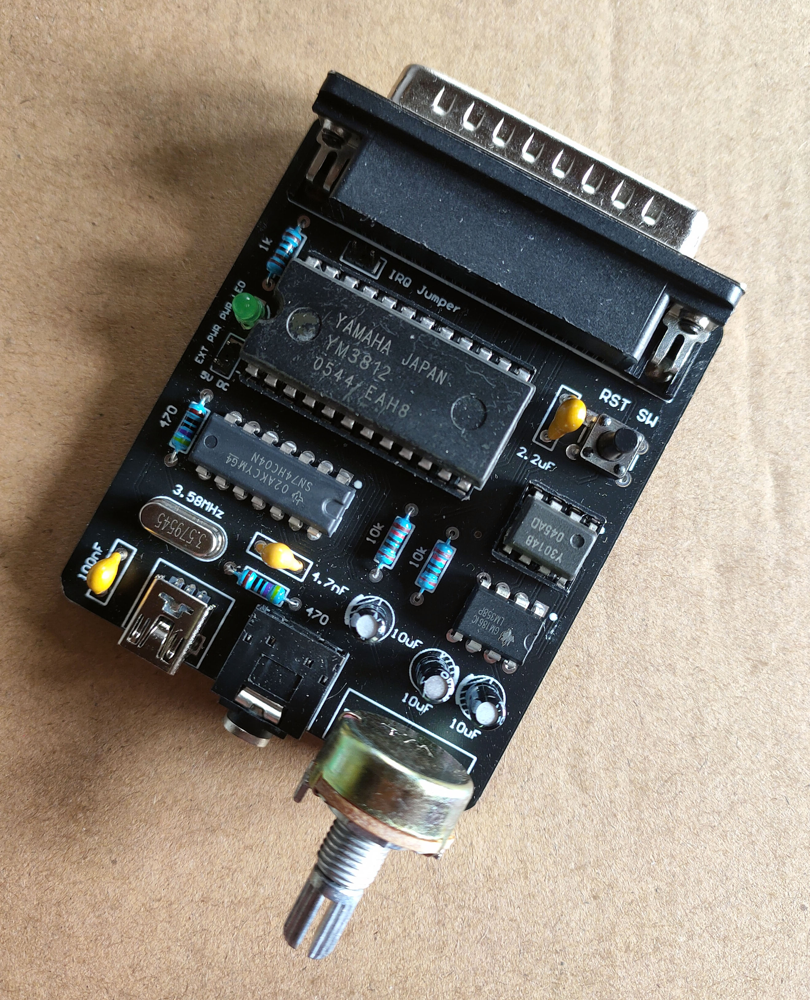
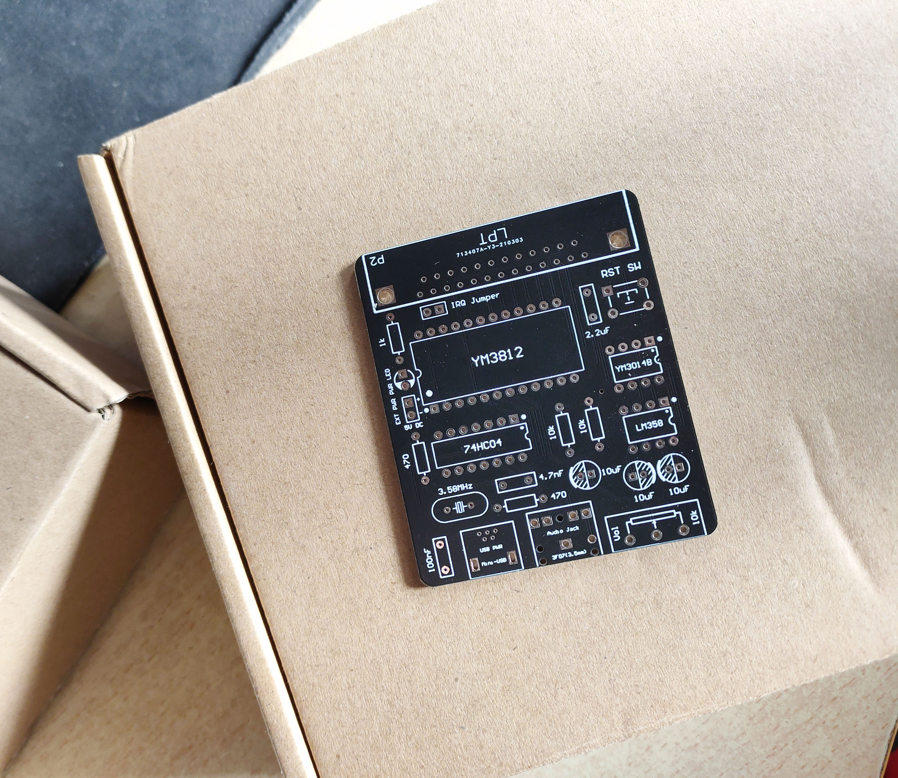

# OPL2LPT-Replica

## Introducción
**OPL2LPT-Replica** es una versión rediseñada, simplificada y de código abierto del circuito OPL2LPT, con menos componentes y bajo licencia MIT, que actúa como un sintetizador FM YM3812 en el puerto LPT, y es totalmente compatible con la ***Tarjeta Adlib***.

Compra la versión original de OPL2LPT y obtén más información en: https://www.serdashop.com/OPL2LPT

## Desarrollo y Fabricación
- Por favor, utilice ***Altium Designer 16*** o superior para abrir o editar el proyecto de PCB

- Los archivos Gerber y los archivos de taladro NC ya están exportados en la carpeta `gerbers`, para que las muestras de PCB puedan fabricarse fácilmente

   Se recomienda usar https://www.jlc.com/ para pedir muestras de PCB en China

   
## Lista de Componentes

| Componente                       | Designador | Cantidad | Nota y posibles fuentes                                      |
| -------------------------------- | ---------- | -------- | ------------------------------------------------------------ |
| MLCC con plomo 100pF (101)       | C1         | 1        | Mouser 594-K101J15C0GF5UH5                                   |
| MLCC con plomo 100nF (104)       | C2         | 1        | Mouser 594-K104K15X7RF5UL2                                   |
| Capacitor polarizado con plomo 10uF | C3, C5, C6 | 3        | Mouser 667-ECA-1EM100                                        |
| MLCC con plomo 2.2uF (225)       | C4         | 1        | Mouser 81-RDER71H225K2M1H3A                                  |
| LED verde con plomo 3mm          | D1         | 1        | Mouser 630-HLMP-Y801-JPP00                                   |
| Inversores CMOS 74HC04           | IC1        | 1        | Mouser 595-CD74HC04E                                         |
| DAC Yamaha YM3014B               | IC2        | 1        | https://www.aliexpress.com/item/32611185781.html, se recomienda zócalo DIP-8 |
| OPL2 Yamaha YM3812               | IC3        | 1        | https://www.aliexpress.com/item/32595976031.html, se recomienda zócalo DIP-24 |
| Amplificador operacional dual LM358 | IC4        | 1        | Mouser 595-LM358AP                                           |
| Conector Mini USB Tipo B con plomo | P1         | 1        | Mouser 571-2172034-1                                         |
| Conector Macho D-Sub 25P R/A     | P2         | 1        | Mouser 523-L717SDB25P1ACH3R                                  |
| Header 2P 2.54mm                 | P3, W1     | 2        | Mouser 855-M20-9990246                                       |
| Toma de audio estéreo 3F07 3.5mm | P4         | 1        | https://www.aliexpress.com/i/32478957056.html                |
| Resistencia 1k 1/4W              | R1, R2, R3 | 3        | Mouser 279-YR1B1K0CC                                         |
| Potenciómetro 10k WH148          | R4         | 1        | https://www.aliexpress.com/item/32998649900.html             |
| Resistencia 10k 1/4W             | R5, R6     | 2        | Mouser 279-YR1B10KCC                                         |
| Tecla TSW DIP-6\*6\*11           | S1         | 1        | https://www.aliexpress.com/item/32725384168.html             |
| Cristal HC-49S 3.58MHz           | Y1         | 1        | Mouser 449-LFXTAL032257BULK                                  |

## Notas para el Montaje y las Pruebas
- Se necesita alimentación de CC de 5V, ya sea desde el puerto Mini-USB o desde los pines de alimentación externos

- Intente presionar **RST SW** para aplicar un reinicio manual cuando el YM3812 se comporte de manera anormal

- Los parámetros detallados de los componentes están anotados en la serigrafía de la placa

- El cristal debe ser de 3.58MHz para obtener la afinación precisa de las notas

- No se recomienda utilizar el 74LS04 para sustituir al 74HC04 en el oscilador de Pierce

  **Nota**: Si el oscilador no funciona, reemplace los dos resistores de 1k ohmios alrededor del CI 74HC04 por resistores de mayor valor, como 4.7k ohmios. También podría ser necesario un ajuste fino del capacitor MLCC de 100pF (101) alrededor del 74HC04.

- Controladores de código abierto disponibles para este proyecto:
  - en MS-DOS: https://github.com/pdewacht/adlipt
    
    funciona correctamente usando cualquiera de los siguientes métodos
    
    - Usando el TSR `adlipt` para el mapeo de puertos (con emm386.exe)
    - Usando `adpatch` para parchear parte de los juegos de DOS
    
  - en Windows 3.1: https://github.com/andreiw/adlib21
## Registro de Actualizaciones
- Versión 0.1(beta): Primera PCB para depuración
- Versión 0.2(beta):
  - Una PCB rediseñada más pequeña
  - Calidad de audio mejorada
- Versión 0.3(beta): Corrección de la red GND no conectada para la toma de audio de 3.5mm
- Versión 1.0:
  - Primera versión actualizada en https://github.com/
  - Corrección del problema del LED de alimentación y del control de volumen
  - Uso de esquinas redondeadas en la PCB para facilitar el montaje (con una carcasa impresa en 3D)
  - Se eliminaron los resistores de pull-up en el bus para mejorar la compatibilidad con algunas computadoras antiguas
  - Se utiliza un puerto Mini-USB no SMT, lo que facilita la soldadura a mano
  - Se agregaron pines de alimentación externa de CC de 5V
- Versión 1.0.1:
  - Se agregó una carcasa impresa en 3D (con tapa) y perilla
  
    Gracias a **@zhblue** por sus increíbles modelos *.stl
  
  - Cambio de la estructura de directorios para el repositorio de GitHub

- Versión 1.1.0:
  - Corrección del problema del reloj causado por resistores y capacitores inadecuados para el oscilador de Pierce
  - Se agregó la Lista de Componentes y algunas imágenes a este documento README
  - Se exportó la versión PDF para los documentos del esquema y la PCB
